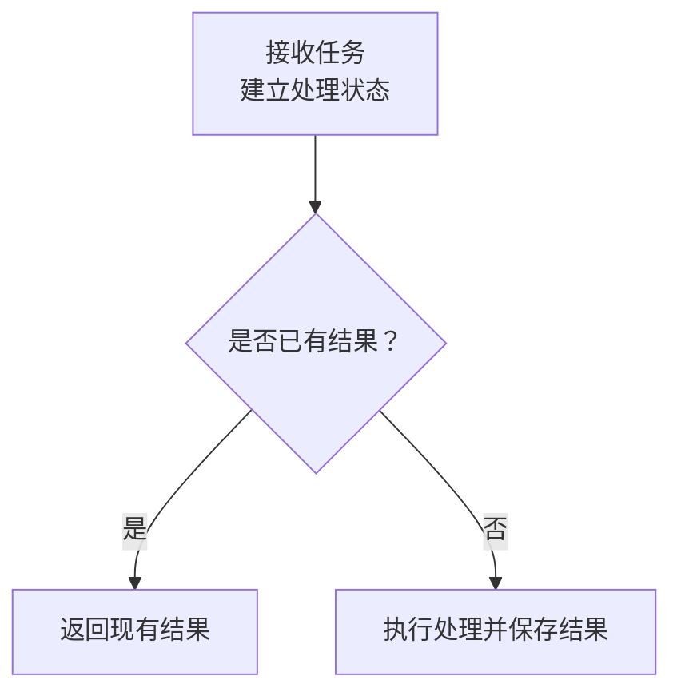

# 源码研究与讲解

本页用于研究代码库、解释一个机制或追踪设计演进。目标是让读者理解系统解决什么问题、为何采用当前设计、实际怎样运行，并能从结论回到证据。

## 按问题选择研究视角

### 建立概览

面对陌生仓库或全局研究请求，先定位产品能力、运行入口、后台系统、主要协作方及职责边界。把用户可见功能与实现入口连起来，追踪关键读写路径，形成可继续深入的系统认识。

广泛研究可以形成架构概览和功能清单，必要时为主要子系统安排独立阅读路径。研究局部机制时只补足所需背景；已有概览足够就复用，不要求先建立全仓库目录。

### 研究具体机制

从具体问题进入：它要完成什么，最直接的实现能做到哪一步，哪些真实约束需要当前机制。

沿公开入口或编排位置追踪领域处理、持久化、事件、后台任务和外部边界。先讲清正常主流程，再解释会改变结果的条件、状态转换、回退、清理和职责交接。测试和配置用于澄清支持范围与运行条件；可用的真实输出、持久记录、队列状态或会话文件用于核实运行事实。

围绕当前问题选取证据，不把函数逐行翻译成段落。已有代码能确定的结论直接使用；运行环境、功能开关或外部行为尚未核实时，准确限制结论范围。

### 追踪设计演进

依据版本差异、提交、迁移、兼容层、历史方案和运行记录重建可证实的阶段。说明当时的问题、实际选择及后续变化，保留来源时间与版本。

现有设计可以用一个更简单的模型解释其必要性；这种概念推导不证明团队曾经实现或否决过该模型。找不到历史理由时说明哪些行为已确认、哪些原因属于推断，避免编造演进故事。

## 让读者理解设计的来由

用具体情境引入问题，再逐步解释约束如何影响设计。适合时按以下脉络展开，简单问题可以合并：

```text
实际问题 → 简单可行的模型 → 真实约束 → 必要机制 → 实际流程 → 职责与取舍
```

先让读者理解某项职责，再引入代码中的名称。例如，先说明压缩后需要用“历史边界、摘要和保留的近期消息”重建会话，再介绍 `CompactionResult` 如何表达这三部分。

正文用连贯段落解释因果关系，章节围绕当前要解决的问题组织。列表适合平行事实、候选比较、代码入口和来源。页面先交代要解释的现象与结论，再展开支持它的推导；读者无需翻开源码才能理解整条路径。

## 展示实际变化的状态

机制涉及持久化、缓存、并发、计量或复杂分支时，展示能解释结果的具体对象：输入输出、消息或数据形状、计数器、队列项、状态转换、开关及回退结果。

优先用真实证据，构造示例明确标注。按正常处理顺序解释对象由谁创建、改变、传递和结束，以及哪些状态必须跨越边界保留。只描述函数调用不足以说明状态为何正确。

图用于表达难以仅凭文字理解的连接、顺序、分支或职责。复杂机制可以先画简单路径，再补约束引出的处理环节；只有能增加理解时才补总图。沿用项目现有绘图形式。

使用 Mermaid 流程图时，标签加引号，换行使用 `<br/>`：



这是构造的表达示例，真实页面按已核实流程绘制。

## 让代码承担证明作用

引用代码用于证明关键判断、分支、不变量、接口形状或职责；先说明片段证明什么，再展示必要部分。语言细节掩盖设计含义时用简短注释解释条件和生命周期。

来源引用靠近对应事实，指向真实文件、符号及适用版本。用户需要跨设备阅读时提供仓库中的相对路径或版本链接。术语和代码标识符保持原名，解释使用读者语言。

交付前脱离源码读一遍：背景是否足够，主流程与重要分支是否明确，状态和职责是否可见，代码是否支持结论，选择理由是否与历史证据的强度相符。持久化范围按主流程决定，不为一次解释自动创建整套 Wiki。
